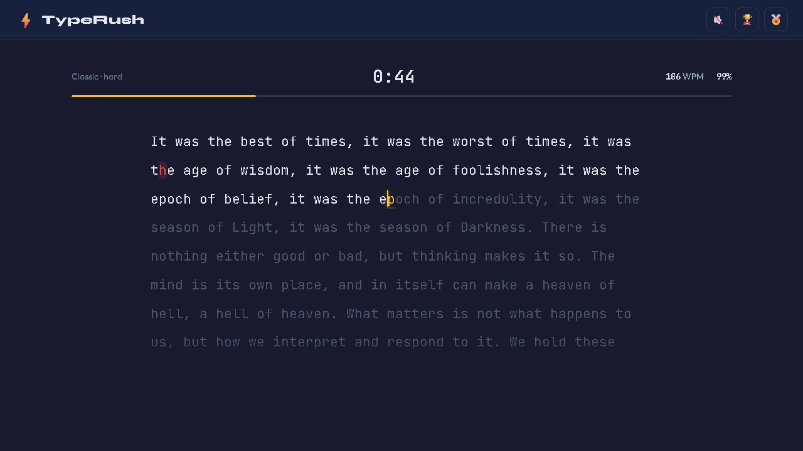

# TypeRush — How fast can you type?

A typing speed game with four modes, live WPM tracking, code snippet challenges, achievements, and a personal leaderboard. Plain HTML, CSS and JavaScript: no dependencies, no build step.

**Live demo:** [https://0xmortuex.github.io/TypeRush/](https://0xmortuex.github.io/TypeRush/)



## Modes

| Mode | What you type | How it ends |
| --- | --- | --- |
| **Classic** | Quotes and excerpts at Easy, Medium or Hard | Timed: 15, 30, 60 or 120 seconds. Quotes keep coming until the time is up. |
| **Code** | Real snippets in JavaScript, Python, HTML, CSS or Rust | Timed: 15, 30, 60 or 120 seconds. Snippets keep coming, separated by a blank line. |
| **Words** | 25, 50, 100 or 200 random words, no punctuation | When the last word is typed. The clock counts up. |
| **Custom** | Your own text (at least 10 characters) | When the last character is typed. The clock counts up. |

The clock starts on your first keystroke. In Code mode, <kbd>Tab</kbd> types two spaces of indentation at a time and <kbd>Enter</kbd> types the line break.

Text pasted into Custom mode is tidied so every character can be typed: curly quotes become straight quotes, en and em dashes become hyphens, an ellipsis becomes three dots, non-breaking and zero-width spaces and tabs are replaced or removed. Letters of any alphabet are left as they are.

## Features

- **Live stats** — WPM, accuracy, time and progress while you type.
- **Results** — WPM, raw WPM, accuracy, consistency, a WPM-over-time chart (SVG), a correct/error breakdown and your most mistyped keys.
- **Achievements** — 10 to unlock, announced with a toast.
- **Leaderboard** — scores you choose to save, with filtering by mode and sorting by WPM, accuracy or date. The 50 fastest runs of each mode are kept.
- **Pause** — <kbd>Esc</kbd> opens a pause menu (Resume, Restart, Quit). Clicking away or switching tabs also stops the clock until you come back.
- **Sound effects** — optional keystroke sounds (Web Audio API), off by default.
- **Reduced motion** — animations are skipped when the system asks for reduced motion.
- **Works offline** — everything runs in the browser. The fonts come from Google Fonts when you are online; without them the game falls back to system fonts.

## Keyboard

The whole game can be played without a mouse.

| Where | Key | Does |
| --- | --- | --- |
| Home | <kbd>Tab</kbd>, then <kbd>Enter</kbd> or <kbd>Space</kbd> | Choose options, press a mode's **Start Typing** button |
| Game | <kbd>Esc</kbd> | Pause menu; <kbd>Esc</kbd> again resumes |
| Game | <kbd>Backspace</kbd> | Take back a character |
| Game (Code) | <kbd>Tab</kbd> | Type two spaces of indentation |
| Results | <kbd>Enter</kbd> | Try again with the same settings |
| Results | <kbd>Esc</kbd> | Back to the mode list |

The results shortcuts are ignored for the first second, so keys you were still typing when the time ran out do not restart the round.

## How the numbers are calculated

- **WPM** — characters that are correct in the text, divided by 5, per minute of typing time. Uncorrected mistakes do not count towards it.
- **Raw WPM** — every character in the text, right or wrong, divided by 5, per minute.
- **Accuracy** — correct keystrokes out of all character keystrokes. A mistake still counts after you fix it with Backspace, and 100% is only shown for a round with no mistakes at all.
- **Typing time** — from the first keystroke to the last character (or to the buzzer of a timed test), minus any time spent paused. A timed test never counts more than its own length.
- **Consistency** — how steady your WPM stayed, from its reading at each second of the round: Excellent, Good, Fair or Poor (coefficient of variation below 10%, 20%, 35%, or above). Rounds shorter than two seconds show N/A.
- **Personal best** — compared with the scores saved on your leaderboard for the same mode and the same difficulty (Classic) or language (Code).

## How to run it

Open `index.html` in a browser, or serve the folder with any static file server, for example:

```sh
python -m http.server 3000
```

Then open <http://localhost:3000>.

## Saved data

Everything is stored in the browser's `localStorage`. Nothing is sent anywhere.

| Key | Contents |
| --- | --- |
| `typerush_leaderboard` | Array of saved scores: `mode`, `difficulty` (Classic), `language` (Code), `wordCount` (Words), `duration`, `wpm`, `rawWpm`, `accuracy`, `consistency`, `date`, `textPreview` |
| `typerush_achievements` | Array of unlocked achievement ids |
| `typerush_stats` | Counters for achievements: `totalTests`, `codeTests`, `classicTests`, `highAccuracyCount` |

All access goes through `js/storage.js`. If the browser blocks or fills up storage, or a stored value is damaged, the game tells you with a toast and keeps working with what it can read.

## Project layout

```
index.html          the single page: home, game, results, leaderboard, achievements
css/                main.css (layout, home, leaderboard), game.css, results.css
js/texts.js         quotes, code snippets, word list, text streams, custom-text tidying
js/game.js          the engine: timing, WPM, accuracy, pause
js/storage.js       localStorage access with error reporting
js/leaderboard.js   saved scores
js/achievements.js  achievements and their counters
js/results.js       the results screen and its chart
js/app.js           views, rendering, keyboard input
tests/              unit tests for the logic above
```

## Tests

The tests load the same script files the browser runs into an isolated context with a fake clock, a fake animation-frame queue and an in-memory `localStorage`. They use only Node's built-in test runner, so there is nothing to install:

```sh
node --test
```

Developed and run with Node 26. The only modules used are `node:test`, `node:assert`, `node:vm`, `node:fs`, `node:path` and `node:url`.

## Known limitations

- Typing is read from keyboard key events. On-screen keyboards that do not send them (commonly the case on Android) will not register keystrokes, so a physical keyboard is needed there. The layout itself adapts to phone and tablet screens.
- Characters that need an input method editor (IME) to compose cannot be typed.
- Sound is off again each time the page is loaded.

## Tech stack

Vanilla HTML, CSS and JavaScript.

- Data in `localStorage`
- Charts built with SVG
- Sound via Web Audio API oscillators
- Fonts: Syne, JetBrains Mono, Outfit (Google Fonts)

## License

MIT
